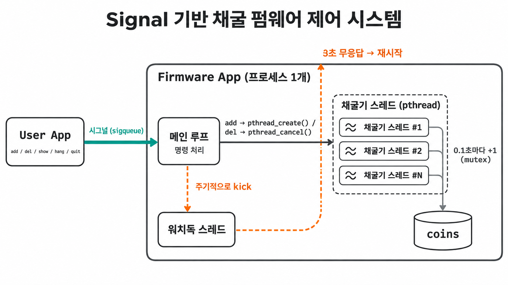
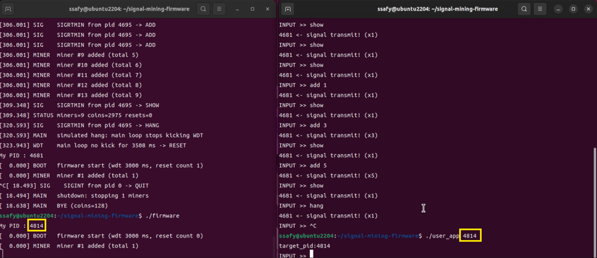
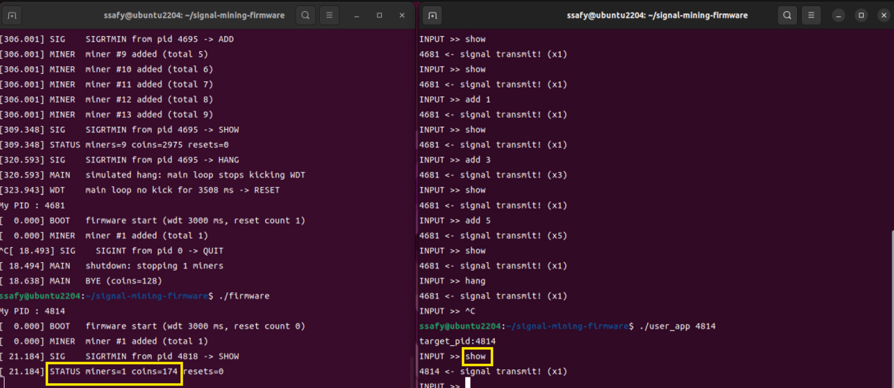
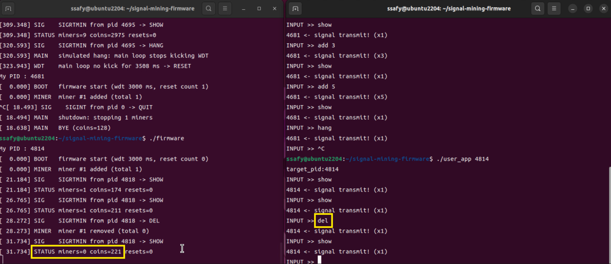
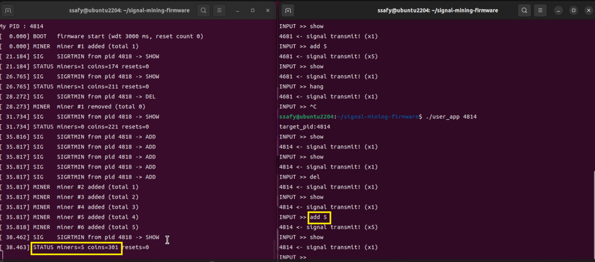
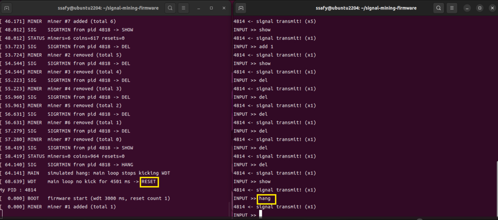
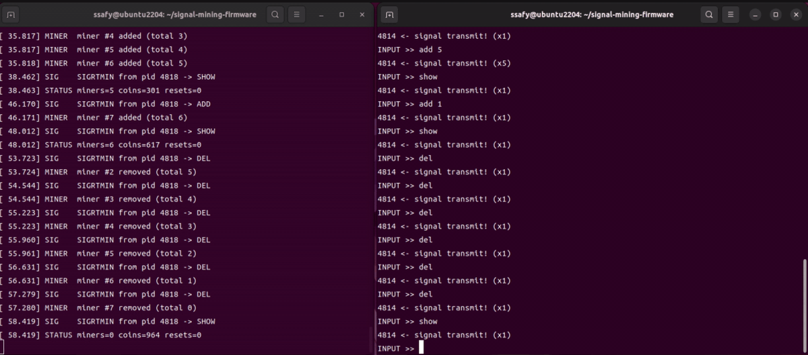

# Signal 기반 채굴 펌웨어 제어 시스템

User App이 보내는 시그널로 Firmware App 안의 채굴기 스레드를 추가·제거·조회하고, 워치독 스레드가 펌웨어 메인 루프의 멈춤을 감지해 재시작하는 Linux C 프로젝트다.

- Firmware App(`src/firmware.c`): 채굴기 스레드를 큐로 관리하고, 시그널을 명령으로 받아 처리한다. 시그널은 핸들러 대신 전용 스레드가 `sigwaitinfo()`로 받는다.
- User App(`src/user_app.c`): 펌웨어 PID를 인자로 받아 사용자 입력을 시그널로 바꿔 보낸다. 명령은 실시간 시그널 하나에 명령 번호를 실어 `sigqueue()`로 보낸다.
- Watchdog(`src/watchdog.c`): 메인 루프가 일정 시간 동안 kick 하지 않으면 timeout으로 보고 펌웨어를 다시 exec 한다.
- 범위는 [구현 범위](#구현-범위)에 정리했다.

| 항목 | 내용 |
|---|---|
| 과정 | SSAFY 16기 임베디드 트랙, 리눅스 시스템 프로그래밍 |
| 인원 | 1명 |
| 사용 기술 | C, POSIX 스레드(pthread, mutex, condition variable, cancel/join), POSIX 시그널(sigwaitinfo, sigqueue, 실시간 시그널), execv |
| 개발 환경 | Linux (테스트: Ubuntu 24.04, gcc 13.3), Makefile |

---

## 프로젝트 배경

### 펌웨어와 외부 제어
임베디드 장치의 펌웨어는 보통 메인 루프 하나가 계속 돌면서 일을 처리하고, 버튼이나 외부 장치의 요청은 인터럽트로 들어온다. 인터럽트 핸들러(ISR)는 짧게 끝내야 하기 때문에, 핸들러는 "무슨 일이 왔다"는 표시만 남기고 실제 처리는 메인 루프가 맡는 구조를 많이 쓴다.

Linux 사용자 공간에서 이 인터럽트 역할을 하는 것이 시그널이다. 이 프로젝트는 User App이 보낸 시그널을 Firmware App이 버튼 입력처럼 받아 처리한다. 다만 시그널 핸들러 안에서는 `printf()`나 `pthread_mutex_lock()` 같은 함수를 안전하게 쓸 수 없다(async-signal-safe가 아님). 그래서 핸들러를 쓰지 않고, 시그널을 막아 둔 뒤 전용 스레드가 동기적으로 꺼내 이벤트 큐에 넣는 방식을 택했다.

### 워치독(WDT)
펌웨어가 무한 루프나 교착 상태에 빠지면 외부에서 알아챌 방법이 없다. 하드웨어 워치독은 펌웨어가 주기적으로 타이머를 리셋(kick)하지 않으면 보드를 재시작한다. 이 프로젝트는 같은 동작을 스레드로 만들었다. 메인 루프가 kick을 멈추면 워치독 스레드가 감지하고, 보드 리셋 대신 프로세스를 다시 exec 한다.

### 구현 범위

- 채굴기 스레드 추가/제거(가장 오래된 것부터)/조회
- PID 출력, SIGUSR1/SIGUSR2/SIGTERM/SIGINT 수신
- PID 인자로 시그널을 보내는 User App
- 전용 스레드 `sigwaitinfo()` + 이벤트 큐
- `sigqueue()` + 실시간 시그널 하나로 명령 전달
- 소프트웨어 워치독, timeout 시 `execv()` 재시작
- 정상 종료 시 모든 스레드 cancel/join

---

## 1. 내가 맡은 역할

1. 구조 설계: 시그널 스레드 → 이벤트 큐 → 메인 루프 → 채굴기 스레드, 그리고 메인 루프를 감시하는 워치독
2. 채굴기 관리 구현: 스레드 추가, 가장 오래된 것부터 제거
3. Firmware App, User App 구현: PID 기반 시그널 송수신, 명령 프로토콜
4. 시그널 프로토콜 개선: 표준 시그널의 합쳐짐과 순서 바뀜을 재현하고 `sigqueue()` 방식으로 바꿈
5. 워치독과 재시작, 정상 종료 순서 구현
6. 통합 테스트 스크립트(`tests/test_integration.sh`) 작성

---

## 2. 구조와 동작 흐름



| 구성 | 펌웨어에 비유하면 | 역할 |
|---|---|---|
| User App (`src/user_app.c`) | 외부 버튼 / 호스트 | 사용자 입력을 명령 번호로 바꿔 시그널로 보낸다 |
| 시그널 스레드 (`signal_thread()`) | 인터럽트 핸들러 | 시그널을 받아 이벤트로 바꿔 큐에 넣기만 한다 |
| 이벤트 큐 (`ev_push()`, `ev_pop()`) | ISR과 메인 루프 사이의 버퍼 | 크기 64의 원형 큐. mutex와 condition variable로 보호 |
| 메인 루프 (`main()`) | 펌웨어 메인 루프 | 이벤트를 꺼내 채굴기를 추가·제거하고 상태를 출력한다. 매 반복마다 워치독을 kick 한다 |
| 채굴기 스레드 (`src/miner.c`) | 작업 태스크 | 0.1초마다 공용 코인 카운터를 1 올린다 |
| 워치독 스레드 (`src/watchdog.c`) | 하드웨어 WDT | 마지막 kick 이후 시간이 timeout을 넘으면 재시작한다 |

---

## 3. 핵심 구현

### 시그널 프로토콜 (`src/common.h`)

| User App 입력 | 보내는 시그널 (기본) | `-l` 모드 (`kill()` 방식) | Firmware 동작 |
|---|---|---|---|
| `1`, `add [N]` | `SIGRTMIN` + `CMD_ADD` | `SIGUSR1` | 채굴기 N개 추가 |
| `2`, `del [N]` | `SIGRTMIN` + `CMD_DEL` | `SIGUSR2` | 가장 오래된 채굴기 N개 제거 |
| `show` | `SIGRTMIN` + `CMD_SHOW` | - | 채굴기 수, 코인 수, 리셋 횟수 출력 |
| `hang` | `SIGRTMIN` + `CMD_HANG` | - | 메인 루프를 멈춤 (워치독 테스트용) |
| `3`, `quit` | `SIGRTMIN` + `CMD_QUIT` | `SIGTERM` | 정상 종료 |
| `exit` | 보내지 않음 | - | User App만 종료 |

Firmware는 `SIGUSR1`, `SIGUSR2`, `SIGTERM`도 받는다. 그래서 셸에서 `kill -USR1 <pid>`로 채굴기를 추가할 수 있고, `kill -TERM <pid>`나 Ctrl+C(`SIGINT`)로 끝내도 같은 정상 종료 경로를 탄다.

### 채굴기 관리 (`src/miner.c`)

| 함수 | 동작 |
|---|---|
| `miner_add()` | `pthread_create()` 성공 후에만 원형 큐에 넣는다. 최대 100개 |
| `miner_del()` | `queue[front]`를 `pthread_cancel()` → `pthread_join()` → 둘 다 성공하면 dequeue |
| `miner_del_all()` | 큐가 빌 때까지 `miner_del()` 반복 |
| `miner_count()`, `miner_coins()` | 큐 크기, 코인 수를 각각 mutex 안에서 읽는다 |

- 제거는 cancel → join → dequeue 순서다 ([4-A](#a-채굴기-제거-순서)). 큐는 `front`와 `size`를 쓰는 원형 큐라서 추가·제거를 반복해도 앞쪽 칸이 버려지지 않는다.

---

## 4. 어려웠던 문제와 해결 과정

### A. 채굴기 제거 순서
처음 만든 채굴기 관리 코드(`docs/troubleshooting/miner_v1_failed.c`)는 `del`을 입력하면 엉뚱한 채굴기가 사라지거나 프로그램이 죽었다. 원인은 `del()`과 `dequeue()`의 순서였다.

```c
/* 실패한 버전 */
int dequeue() {
    if (front == rear) return -1;
    front++;                       /* (1) 먼저 front를 옮기고 */
    return queue[front];           /* (2) 옮긴 칸을 돌려준다 → 가장 오래된 칸이 아님 */
}
int del() {
    dequeue();                     /* front가 이미 다음 칸으로 넘어감, 반환값도 무시 */
    pthread_cancel(queue[front]);  /* 가장 오래된 채굴기가 아니라 그다음 채굴기를 취소 */
    pthread_join(queue[front], NULL);
}
```

`front++`를 먼저 하기 때문에 `del()`이 취소하는 것은 `queue[front]`, 즉 두 번째로 오래된 채굴기다. 가장 오래된 채굴기는 큐에서만 빠지고 스레드는 계속 돌아서, 누구도 취소할 수 없는 채굴기가 남는다.

컴파일 오류(`enqueue()`의 정의되지 않은 `value`)만 최소로 고친 사본으로 직접 실행해 확인했다.

| 상황 | 결과 |
|---|---|
| 채굴기 3개(0, 1, 2번) 뒤 `del` | 0번이 아니라 1번이 취소됨. 0번은 큐에서 빠진 채로 계속 채굴 |
| 채굴기 1개 뒤 `del` | 취소 대상 `queue[1]`이 한 번도 쓰지 않은 칸(값 0) → `pthread_cancel(0)`에서 Segmentation fault |
| 채굴기 2개 뒤 `del` 두 번 | 첫 `del`은 1번을 취소, 두 번째 `del`은 빈 칸 `queue[2]`를 취소하려다 Segmentation fault |
| 채굴기 없이 `del` | `dequeue()`는 -1을 돌려주지만 `del()`이 무시하고 `queue[0]`(값 0)을 취소 → Segmentation fault |

이 밖에도 `add()`는 `rear == SIZE` 검사보다 먼저 `pthread_create(&queue[rear], ...)`를 호출하기 때문에, 100개를 넘게 추가하면 배열 밖에 스레드 ID를 쓴다.

해결은 순서를 바꾸는 것이었다. `queue[front]`를 먼저 cancel 하고, join으로 종료를 확인한 다음, 둘 다 성공했을 때만 dequeue 한다. 이 순서가 지금의 `miner_del()`이다.

```c
/* src/miner.c miner_del() */
miner_t m = queue[front];
if (pthread_cancel(m.tid) != 0 || pthread_join(m.tid, NULL) != 0) {
    pthread_mutex_unlock(&qlock);
    return -1;
}
front = (front + 1) % MINER_MAX;   /* 종료가 확인된 스레드만 큐에서 뺀다 */
size--;
```

---

## 5. 결과

Ubuntu 22.04 VM에서 실행한 화면이다. 왼쪽은 Firmware App, 오른쪽은 User App이다.

### 1) PID로 연결


- Firmware App을 실행하면 `My PID : 4814`를 출력하고, User App은 이 PID를 인자로 받아(`./user_app 4814`) 시그널을 보낸다.

### 2) show: 상태 조회


- 시작할 때 만든 채굴기 1개가 돌고 있어 `miners=1 coins=174`가 출력된다.

### 3) del: 가장 오래된 채굴기 제거


- `del`로 `miner #1`을 제거하면 `miners=0`이 되고, 이후 코인은 더 늘지 않는다(`coins=221`).

### 4) add: 채굴기 추가


- `add 5`로 시그널 5개를 연속으로 보내면 5개가 모두 처리되어 `miner #2`\~`#6`이 추가되고, `show`에서 `miners=5`가 확인된다.

### 5) hang: 워치독 재시작




- `hang`으로 메인 루프를 멈추면 워치독이 kick이 끊긴 것을 감지하고 `RESET`한다.
- 재시작한 뒤에도 `My PID : 4814`로 PID가 같고(`reset count 1`), 채굴기는 초기 상태인 1개로 돌아간다.

---

## 6. 배운 점

1. 스레드 정리 순서: `pthread_cancel()`은 취소를 요청할 뿐이고, 실제로 끝났는지는 `pthread_join()`으로 확인해야 한다. 자료구조에서 지우는 일은 확인 다음이어야 한다는 것을 실패한 코드로 직접 겪었다.
2. 시그널은 "횟수"와 "순서"를 보장하지 않는다: 표준 시그널은 합쳐지고, 서로 다른 시그널은 번호 순서로 나간다. 사람이 천천히 입력할 때는 보이지 않다가, 프로그램이 연속으로 보내자 바로 드러났다. 명령 채널로 쓰려면 같은 실시간 시그널 하나에 값을 싣는 식으로 설계해야 한다.
3. 시그널과 스레드를 같이 쓰는 법: 핸들러 안에서 할 수 있는 일은 매우 적다. 모든 스레드에서 막고 전용 스레드가 `sigwaitinfo()`로 받으면 일반 코드처럼 다룰 수 있고, ISR과 메인 루프를 나누는 펌웨어 구조와도 잘 맞았다.
4. 감시와 복구: 워치독은 "멈췄다"를 직접 알 수 없으니 "살아 있다는 신호가 끊겼다"로 판단한다는 것, 그리고 복구 방식(exec)에 따라 PID 유지 여부와 잃어버리는 상태가 달라진다는 것을 정리할 수 있었다.
